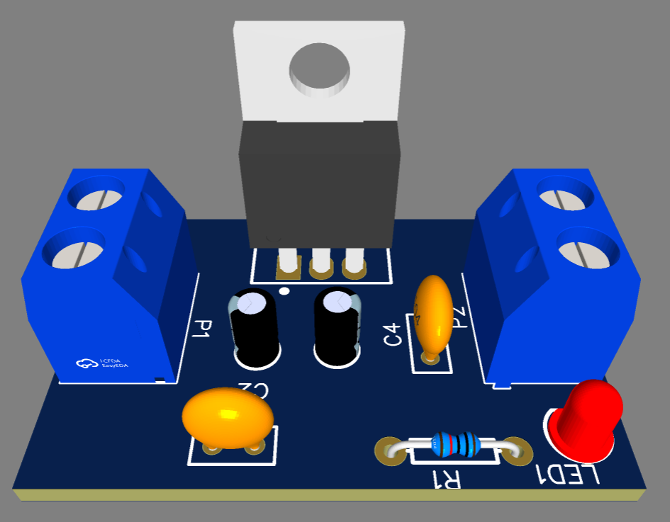

# 7805 Voltage Regulator – PCB Design

## Project Overview

This project is a 5V regulated DC power supply designed using the LM7805 linear voltage regulator.

The PCB is designed in EasyEDA Standard using through-hole components and a single-sided PCB layout.

The project demonstrates practical skills in electronic circuit design, schematic capture, PCB layout, component selection and PCB documentation.

## Project Specifications

| Parameter | Specification |
|---|---|
| Project | 7805 Voltage Regulator |
| Controller / IC | LM7805T |
| Input Voltage | 9–12V DC (design target) |
| Output Voltage | Regulated 5V DC |
| PCB Type | Single-sided |
| Components | Through-hole |
| Design Software | EasyEDA Standard |
| Output | 5V DC regulated supply |

*The actual supported load current and thermal performance depend on the regulator, heatsinking and operating conditions.*

## Components Used

| Component | Designator | Value |
|---|---|---|
| Voltage Regulator | U1 | LM7805T |
| Electrolytic Capacitors | C1, C2 | 100µF |
| Ceramic Capacitor | C3 | 330nF |
| Ceramic Capacitor | C4 | 100nF |
| Resistor | R1 | 1kΩ |
| LED | LED1 | Red 3mm |
| Input Connector | P1 | 2-pin |
| Output Connector | P2 | 2-pin |

## Working Principle

1. DC input voltage is supplied through the input connector.
2. The LM7805T regulates the input voltage to approximately 5V.
3. Capacitors help filter input and output voltage variations.
4. The LED provides a visual power indication.
5. The output connector provides the regulated 5V supply.

## Design Features

- LM7805-based regulated power supply
- Single-sided PCB layout
- Through-hole component design
- Input and output screw terminals
- Input and output filtering capacitors
- LED power indication
- EasyEDA 3D PCB visualization

## Software and Tools

- EasyEDA Standard
- PCB layout and schematic design tools
- Gerber generation
- BOM generation

## Project Files

- `Schematic_7805-Voltage-Regulator_2026-11-15.pdf` – Circuit schematic
- `BOM_7805-Voltage-Regulator_2026-11-15 (2)(1).csv` – Bill of Materials
- `Gerber_7805-Voltage-Regulator_PCB_7805-Voltage-Regulator_2_2026-11-15.zip` – PCB manufacturing files
- `PCB_3D_View.png` – 3D PCB visualization

*Update these filenames if you rename the files in your repository.*

## Learning Outcomes

Through this project, I developed practical knowledge of:

- Voltage regulator circuits
- Electronic component selection
- Schematic design
- PCB footprint selection
- Single-sided PCB routing
- PCB design rule checking
- Gerber and BOM generation

## Project Status

**PCB design completed.**

Physical fabrication and hardware testing should be documented separately once completed.

## Author

GitHub: https://github.com/cheguevarasigma-lab

---

*This project is part of my practical Electronics and Electrical Engineering learning portfolio.*
